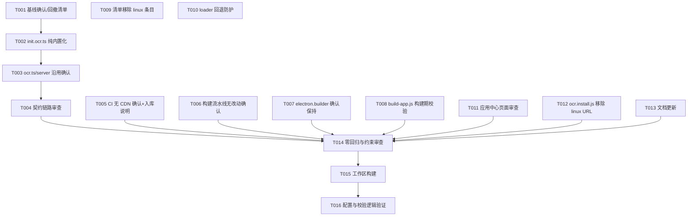

# Tasks: 桌面端 OCR 功能 Linux 适配（v2：纯内置分发）

**Input**: Design documents from `spec/ocr-linux-support/`（v2）
**Prerequisites**: plan.md (required), spec.md (required for user stories)
**Verification scope**: build-only（Phase 3 Verification Choice Gate 选择 "Run verification"）
**Baseline**: v1 已实现并验证（T001–T022 完成，CDN 分发方案）；v2 任务为范围变更增量——移除 Linux CDN 链路、纯内置化、回退防护与构建期防呆

**Organization**: Tasks are grouped by user story to enable independent implementation and testing of each feature increment.

## Format: `[ID] [P?] [Story] Description`

- **[P]**: Can run in parallel (different files, no dependencies on incomplete tasks)
- **[Story]**: Which user story this task belongs to (US1–US4, mapping to spec.md v2 user stories)
- Include exact file paths in descriptions

## 路径约定

- 应用侧改动位于 `honghueasystudy_desktop/` 子工作区（Electron desktop）
- 分发/清单/CI 改动位于仓库根工作区（`scripts/`、`website/`、`.github/`）
- 验收方式标注：【本机可验】Windows 主机可完成；【需 Linux 环境】需 Linux 机器或 CI 验收

---

## Phase 1: Setup (Baseline Confirmation)

**Purpose**: v1 实现基线确认与回撤清单梳理

- [X] T001 [P] 审查 v1 实现现状并形成回撤清单：`honghueasystudy_desktop/packages/app/src/tasks/init.ocr.ts`（linux 在线下载分支与 CDN URL）、`website/api/honghu-app-infos.json`（v1 添加的 linux 平台条目）、`scripts/ocr.install.js`（linux-x64/linux-arm64 CDN URL）、`honghueasystudy_desktop/packages/web/src/utils/resources.loader.ts`（arch 匹配能力，保留）——明确每处"回撤/保留/新增"处置【本机可验】

**Checkpoint**: 回撤范围明确，无歧义。

---

## Phase 2: User Story 1 - Linux 启动自动初始化（纯内置） (Priority: P1) 🎯 MVP

**Goal**: Linux 初始化仅从安装包内嵌资源解压安装，零网络请求；缺失静默降级。

**Independent Test**: Linux 环境启动应用验证初始化与断网一致性；本机验证编译与逻辑审查。【需 Linux 环境】（代码改动本机可编译验证）

### Implementation for User Story 1

- [X] T002 [US1] 修改 `honghueasystudy_desktop/packages/app/src/tasks/init.ocr.ts`：移除 Linux 在线下载兜底与 linux CDN URL（`ocr-linux.zip` / `ocr-linux-arm64.zip`）——Linux 仅从内置资源（`resources/bin/ocr/ocr.zip`）解压安装；内置资源缺失时静默降级 `canOCR=false` 且**不发起任何网络请求**；保留系统 `unzip` 优先 + `chmod 0o755` 兜底、ELF 架构校验、幂等初始化（依赖 T001 回撤清单）
- [X] T003 [US1] 审查 `honghueasystudy_desktop/packages/app/src/utils/ocr.ts` 与 `honghueasystudy_desktop/packages/app/src/tasks/startup.server.ts`：确认 v1 实现的 `canOCR` X_OK 判定、`isBinaryExecError` 降级在纯内置模式下语义不变，无下载相关引用残留；如需微调一并修正

**Checkpoint**: Linux 初始化纯内置化完成，零网络请求。

---

## Phase 3: User Story 2 - Linux 验证码识别与滑块检测行为一致 (Priority: P1)

**Goal**: `POST /ocr` 两类调用在 Linux 上与 win/mac 契约一致，自动化脚本零改动（v1 结论在 v2 收窄后仍成立）。

**Independent Test**: 契约链路审查（CLI 参数、stdout 解析、降级路径）无 CDN 引用残留。【本机可验】（运行时比对需 Linux 环境）

### Implementation for User Story 2

- [X] T004 [US2] 审查契约链路：`honghueasystudy_desktop/packages/app/src/tasks/startup.server.ts`、`honghueasystudy_desktop/packages/app/src/utils/ocr.ts`、`honghueasystudy_desktop/packages/app/src/worker/index.ts`、`honghueasystudy_desktop/packages/app/src/scripts/utils/index.ts`——确认 CLI 参数拼接、stdout 解析（文本 trim / 滑块单引号字面量）、`canOCR:false` 降级路径在 v2 收窄后不变，且无 linux CDN URL 残留引用（依赖 T002/T003 完成后的终态）

**Checkpoint**: 契约链路确认一致，无分发残留。

---

## Phase 4: User Story 3 - Linux ddddocr 构建流水线与 CI Artifact 入库 (Priority: P2)

**Goal**: CI 仅产 Artifact，维护者下载后入库 `bin/ocr/linux-<arch>/`；全链路无 CDN 上传。

**Independent Test**: CI workflow 无上传/发布步骤；入库操作说明齐备。【本机可验】

### Implementation for User Story 3

- [X] T005 [P] [US3] 微调 `.github/workflows/ocr-linux-build.yml` 与 `honghueasystudy_desktop/scripts/ocr-linux/README.md`：确认 workflow 无任何 CDN 上传/发布步骤（仅 Actions Artifact 上传）；补充"Artifact 下载 → 放入 `bin/ocr/linux-<arch>/` 提交"的操作说明（workflow 注释与 README 任一或两者）
- [X] T006 [US3] 确认 `honghueasystudy_desktop/scripts/ocr-linux/` 构建流水线（`requirements.txt`、`ocr_entry.py`、`build.py`）无需改动：构建产物仅落本地/Artifact，不涉及分发渠道；如 build.py 存在 CDN/上传相关逻辑（应无）一并移除

**Checkpoint**: 构建交付流为"CI Artifact → 入库"，无 CDN 参与。

---

## Phase 5: User Story 4 - Linux 安装包内嵌与构建期校验 (Priority: P3)

**Goal**: electron-builder linux 内嵌配置保持；Linux 打包前置本地存在性校验（防呆，不下载）。

**Independent Test**: 删除 `bin/ocr/linux-<arch>/ocr.zip` 后打包构建期报错并提示从 CI Artifact 获取。【需 Linux 环境】（配置与校验逻辑本机可验）

### Implementation for User Story 4

- [X] T007 [P] [US4] 确认 `honghueasystudy_desktop/packages/app/electron.builder.json` linux 块 extraResources 映射（`bin/ocr/linux-${arch}` → `resources/bin/ocr`）保持 v1 实现不变，无需改动
- [X] T008 [US4] 修改 `honghueasystudy_desktop/scripts/build-app.js`：Linux 打包前置流程对 `honghueasystudy_desktop/bin/ocr/linux-<arch>/ocr.zip` 执行**仅本地存在性校验**（不下载）——存在则放行；缺失时构建期报错，错误信息提示"从 CI Artifact（`ocr-linux-build.yml`）获取并放入 `bin/ocr/linux-<arch>/` 后重试"；win/mac 前置下载流程不变

**Checkpoint**: 内置打包链路含构建期防呆。

---

## Phase 6: 清单回撤与应用中心回退防护（FR-005 / FR-011 跨故事约束）

**Purpose**: 移除清单 linux 条目；阻断 Linux 上 OCR 资源的 win 默认包回退；移除构建期脚本的 linux CDN URL。

- [X] T009 [P] 修改 `website/api/honghu-app-infos.json`：移除 v1 添加的 ocr 资源 linux 平台条目（`{platform: 'linux', ...}` 两条），恢复为 win 默认 URL + darwin 平台条目；确认 JSON 合法
- [X] T010 [P] 修改 `honghueasystudy_desktop/packages/web/src/utils/resources.loader.ts`：应用中心回退防护——平台无匹配条目的资源在当前平台**不可安装**（不得回退资源默认 URL）；已有可选 `arch` 匹配能力保留不动；win/mac 匹配语义不变
- [X] T011 审查 `honghueasystudy_desktop/packages/web/src/pages/resources/index.vue` 应用中心页面：确认回退防护生效后 Linux 上 OCR 资源不展示/不可安装，win/mac 展示与安装行为完全不受影响（依赖 T009、T010 完成后的终态）
- [X] T012 [P] 修改 `scripts/ocr.install.js`：移除 `linux-x64` / `linux-arm64` CDN 下载 URL（OCR_URLS 相关 linux 条目）；win/mac 下载与校验逻辑不变；linux 不提供下载能力（构建期校验职责移交 T008 的 build-app.js 本地校验）

**Checkpoint**: 清单与构建期脚本无任何 linux CDN 引用；应用中心 Linux 回退防护就位。

---

## Phase 7: Polish & Cross-Cutting Concerns

**Purpose**: 文档同步与零回归审查

- [X] T013 [P] 更新文档：`honghueasystudy_desktop/packages/web/src/pages/guide.vue` 与 `honghueasystudy_desktop/.claude/skills/project-context.md` 中 Linux OCR 描述改为**纯内置分发**（安装包内嵌、无需下载、离线可用），移除任何"Linux CDN 下载/应用中心安装"表述
- [X] T014 零回归与约束审查：全量审查 v2 diff（T002–T013 涉及文件）——win/mac CDN 分发、应用中心、调用、打包路径零回归；Linux 初始化代码路径零网络请求（无 axios/download 调用残留）；清单/loader/build 脚本无 linux CDN 引用残留

---

## Phase 8: Verification

<!-- verification_scope: build-only -->

**Purpose**: 构建验证与配置/校验逻辑验证（用户选择 build-only；Linux 运行时行为需 Linux 环境/CI 验收，不在本机验证范围内）

- [x] T015 构建 honghueasystudy_desktop 工作区（安装依赖 + TypeScript 编译/构建），修复所有编译/构建错误并迭代至构建成功【本机可验】
- [x] T016 验证配置与校验逻辑：审计 `electron.builder.json` 三平台 extraResources 合法性、`website/api/honghu-app-infos.json` JSON 合法性与条目完整性（win 默认 + darwin，无 linux）、`scripts/ocr.install.js` 无 linux URL、`honghueasystudy_desktop/scripts/build-app.js` linux 本地校验逻辑正确性（存在放行/缺失报错提示）【本机可验】

---

## 📊 Dependency Graph



## Dependencies & Execution Order

### Phase Dependencies

- **Setup (Phase 1)**: 无依赖，立即开始
- **US1 (Phase 2)**: T001 后开始；T002 → T003 串行（同链路文件）
- **US2 (Phase 3)**: 依赖 US1 终态（T004 审查基于收窄后代码）
- **US3 (Phase 4)**: 独立，可与 US1/US2 并行
- **US4 (Phase 5)**: 独立，可与 US1–US3 并行
- **清单回撤与回退防护 (Phase 6)**: T009/T010/T012 相互独立可并行；T011 依赖 T009+T010 终态
- **Polish (Phase 7)**: T013 可与实现任务并行；T014 须在全部实现任务（T002–T013）完成后
- **Verification (Phase 8)**: 依赖 T014；T015 → T016 串行收尾

### User Story Dependencies

- **US1 (P1)**: Setup 后即可开始——MVP 核心（纯内置初始化）
- **US2 (P1)**: 衔接 US1 终态审查，可独立验收
- **US3 (P2)**: 独立（CI/构建脚本不依赖应用侧）
- **US4 (P3)**: 配置/校验层独立；T008 防呆校验与 T012（移除下载）协同但不同文件
- **Phase 6 约束组**: 独立于各故事，纯增量回撤/防护

### Within Each User Story

- 同链路文件串行（US1 的 init.ocr.ts → ocr.ts/server）
- 不同文件任务标注 [P] 可并行
- 审查收尾任务（T004、T006、T011）在对应改动完成后执行

---

## Parallel Example: Phase 4–6 独立任务并行

```text
# 以下任务分属不同文件、互不依赖，可并行执行：
Task: "T005 CI workflow 无 CDN 确认 + 入库说明 @ .github/workflows/ocr-linux-build.yml"
Task: "T007 electron.builder.json 确认保持 @ honghueasystudy_desktop/packages/app/electron.builder.json"
Task: "T009 清单移除 linux 条目 @ website/api/honghu-app-infos.json"
Task: "T010 loader 回退防护 @ honghueasystudy_desktop/packages/web/src/utils/resources.loader.ts"
Task: "T012 ocr.install.js 移除 linux URL @ scripts/ocr.install.js"
Task: "T013 文档更新 @ guide.vue / project-context.md"
```

---

## Implementation Strategy

### MVP First (US1)

1. 完成 Setup（T001）
2. 完成 US1（T002–T003）→ Linux 纯内置初始化链路
3. 完成 US2（T004）→ 契约与残留确认
4. **STOP and VALIDATE**: Linux 环境安装包内嵌 ocr.zip 首启验证（无 Linux 环境则本机编译验证 + 后续 CI/真机验收）

### Incremental Delivery

1. Setup → 回撤清单就绪
2. +US1 → 纯内置初始化（配合手工放置 `bin/ocr/linux-<arch>/ocr.zip` 即可端到端）
3. +US2 → 契约确认
4. +US3 → CI Artifact 交付流闭环（构建→下载→入库）
5. +US4 → 构建期防呆
6. +Phase 6 → 清单回撤与应用中心防护
7. Polish → 文档与零回归审查；Verification → 构建收尾

### Parallel Team Strategy

多开发者场景：

1. 开发者 A：US1 → US2（应用主进程链路）
2. 开发者 B：Phase 6 清单/loader/脚本回撤组
3. 开发者 C：US3 + US4（CI 与构建期校验）
4. 汇合后共同完成 T014 零回归审查与 Verification

---

## Summary Report

- **Total tasks**: 16（T001–T016）
- **Per-story count**: Setup 1（T001）；US1 2（T002–T003）；US2 1（T004）；US3 2（T005–T006）；US4 2（T007–T008）；清单回撤与防护组 4（T009–T012）；Polish 2（T013–T014）；Verification 2（T015–T016）
- **Parallel opportunities**: T005/T006/T007/T008/T009/T010/T012/T013 八个任务分属不同文件可与 US1 链路并行；T011 依赖 T009+T010；T014 汇合点
- **Independent test criteria**: US1 看纯内置初始化与断网一致；US2 看契约链路无残留；US3 看 CI 无 CDN 步骤与入库说明；US4 看防呆校验（删 zip 后打包报错）；Phase 6 看清单无 linux 条目且 Linux 应用中心不可安装
- **Suggested MVP scope**: Setup（T001）+ US1（T002–T003）+ US2（T004）——纯内置链路最小闭环；Phase 6 回撤组为发布前必须项
- **验收边界提示**: 应用侧改动【本机可验】编译；Linux 运行时行为、防呆校验触发、AppImage 离线首启【需 Linux 环境】或 CI 验收，已逐条标注

## Notes

- [P] tasks = different files, no dependencies
- v1 已实现且 v2 保持不变的部分（canOCR 判定、解压权限、ELF 校验、electron.builder 映射、构建流水线四文件）以"确认保持"任务（T003/T006/T007）覆盖，避免重复改动引入回归
- `packages/web/src/pages/resources/index.vue` 与 `.claude/skills/project-context.md` 的更新为文档/审查性质
- Commit after each task or logical group
- Stop at any checkpoint to validate independently
