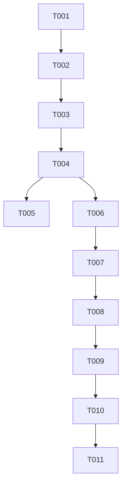

# Tasks: 智慧树登录未完成即读课程（竞态）修复

**Input**: Design documents from `spec/zhs-login-race/`
**Prerequisites**: spec.md
**Baseline**: 读课程门控已存在（`automationReady` / `automation-done`），本次只补「登录页识别 + 有界等待 + 明确提示」

**Organization**: 按 spec 的 US1 / US2 分组；所有改动集中在两个文件，无跨包改动。

## Format: `[ID] [P?] [Story] Description`

- **[P]**: 不同文件、无依赖，可并行
- **[Story]**: 对应 spec.md 的 US1 / US2

---

## Phase 1: Setup

- [X] T001 [P] 确认现状与行号：`honghueasystudy_desktop/packages/app/src/worker/index.ts`（`listCourses`/`readCourseList` 约 1342-1561、`acquireAutomationPage` 约 2192-2241、`enterCourse` 约 1564-1582、`detectCoursePlatform` 约 2328-2335）与 `.../scripts/automation/wk/zhs.ts`（`waitForLogin` 约 198-225）

**Checkpoint**: 改动点无歧义。

---

## Phase 2: US1 - 登录未完成时不再「没找到课程」 (Priority: P1) 🎯 MVP

**Goal**: 读课程 / 进课识别登录页，有界等待后给出明确提示。

### Implementation

- [X] T002 [US1] `worker/index.ts` 新增登录页判定与常量（FR-001）
  - 在 `COURSE_PLATFORMS` / `detectCoursePlatform` 附近新增 `LOGIN_HOST_PREFIX`、`LOGIN_PATH_SEGMENT` 与 `export function isLoginPageUrl(url: string): boolean`
  - 文件顶部常量区新增 `LOGIN_LANDING_TIMEOUT = 15 * 1000`（含注释说明与 3 次重试的关系）
- [X] T003 [US1] `worker/index.ts` 调整页面选择（FR-002）
  - 新增私有 `findLoggedInPlatformPage(exclude?: Page): Page | undefined`：存活、非导航页、`detectCoursePlatform` 命中且 `!isLoginPageUrl`
  - `acquireAutomationPage`：`requirePlatform` 时 cached 需同时满足「平台域名 + 非登录页」；第 2 步改为「先找非登录平台页，找不到再退回登录平台页」
- [X] T004 [US1] `worker/index.ts` 重写 `readCourseList` 的取页与提示（FR-003 / FR-004 / FR-005 / FR-006）
  - 新增私有 `settlePlatformPage(page, timeout)`：1 秒轮询，优先切到 `findLoggedInPlatformPage()`，直到离开登录页或超时
  - `const page` → `let page`；`acquireAutomationPage` 后调用 `settlePlatformPage`，仍为登录页则直接返回 hint「登录还没有完成（页面仍停在智慧树登录页）。请先在浏览器里完成登录/安全验证，再点「刷新课程列表」。」（`platform: ''`、`courses: []`）
  - `attempts` / `frameTargets` 收集时跳过 `isLoginPageUrl`
  - 强制导航 `platform.listUrl` 后：落地为登录页 → 返回「登录状态已失效，课程页被跳转到了登录页。请在浏览器里重新登录后再试。」
  - 导航后的 `page.waitForTimeout(2500)` 改为 `new Promise(setTimeout)`；新增 `safePageUrl(page)` 兜底已关闭页面，用于 `pageUrl` / hint / `onBlankPage` 判定
- [X] T005 [US1] `worker/index.ts` 为 `enterCourse` 加登录页门禁（FR-007）
  - 取页后若 `isLoginPageUrl(page.url())`，抛「登录还没有完成，暂时不能进入课程。请先在浏览器里完成登录/安全验证，再进入。」

**Checkpoint**: 登录失败时读课程 / 进课均返回明确登录提示，不产生误导性文案。

---

## Phase 3: US2 - 登录成功但跳转未落定时自动等待 (Priority: P1)

- [X] T006 [US2] `zhs.ts` 修正 `waitForLogin`（FR-008）
  - 新增 `isLoginEntryUrl(url)`：`^(login|passport)\.zhihuishu\.com` 或 `zhihuishu.com` 下的 `login|signin` 路径
  - 循环内用它替代 `url.includes('login.zhihuishu.com')`
  - 成功条件追加「必须是 http(s) 地址」；等待上限 40s → 60s，同步更新注释
- [X] T007 [US2] 复核 `settlePlatformPage` 与 3 次重试的协同（FR-003 / FR-009）
  - 确认 `readCourseList` 提前返回的 hint 经 `listCoursesWithRetry`（3 次、间隔 8 秒）后仍能透出到 `runStudy` 的最终错误文案
  - 不改 `automationPlan.ts`，除非审查发现 hint 被吞掉

**Checkpoint**: 正常登录后读课程不再偶发空列表报错。

---

## Phase 4: Verification

- [X] T008 类型检查：在 `honghueasystudy_desktop` 执行 `npx --no-install tsc -p packages/app/tsconfig.json --noEmit`，0 error（SC-003）
- [X] T009 逻辑测试（临时脚本，已放系统临时目录并删除，未入库【本机可验】）：worker `isLoginPageUrl` 16 例、zhs `isLoginEntryUrl` 8 例全部通过
  - 覆盖 `isLoginPageUrl` 样本：`https://login.zhihuishu.com/?origin=zhs`、`https://passport.zhihuishu.com/login`、`https://www.zhihuishu.com/login`、`https://onlineweb.zhihuishu.com/onlinestuh5`、`http://i.chaoxing.com/base`、`about:blank`、`chrome-error://chromewebdata/`
  - 覆盖 zhs `isLoginEntryUrl` 样本：上述智慧树登录地址 + `https://www.zhihuishu.com/`、`https://onlineweb.zhihuishu.com/onlinestuh5`
- [X] T010 静态回归审查（SC-004）
  - 超星 / 职教云 / 智慧职教：候选页顺序只多「跳过登录页」，无其它行为差异
  - `enterCourse` 正常路径无新增等待
  - 无新增 RPC 字段，`remoteControl.ts` / `automationPlan.ts` 契约不变
- [ ] T011 交付（待用户明确要求后执行）：`pnpm --filter @honghu-desktop/app dist` 打包 → 校验产物 → 启动应用 → 提交并推送 `origin` 与 `honghueasystudy`。提交/推送按仓库约定只在用户明确要求时执行，本次修复已完成代码与验证。

---

## 📊 Dependency Graph

## Notes

- T002–T005 同文件串行；T006 不同文件，可在 T004 后并行推进
- 所有提示文案统一使用中文，且必须包含「登录」字样，便于用户在自动刷课失败时第一时间定位
- 打包与推送沿用既有流程，须先获得用户确认
